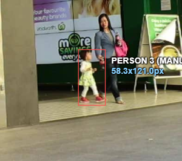
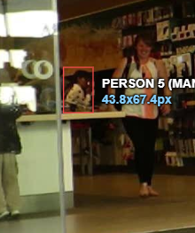
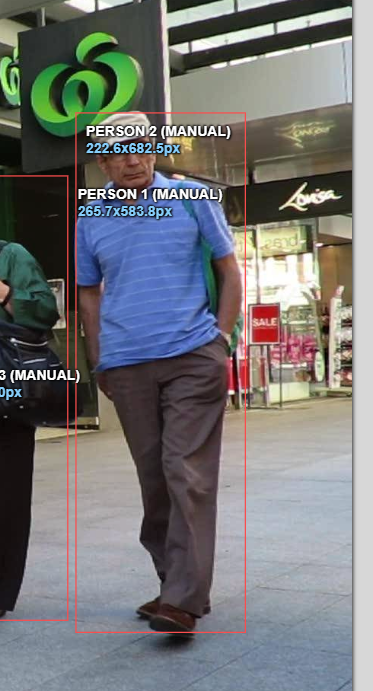

# Báo cáo cá nhân — Nguyễn Thanh Quang (2A202603083)

Đoạn video: MOT17-09, 150 frame (CVAT frame 0–149; `gt.txt` frame 1–150), nguồn MOTChallenge, giấy phép CC BY-NC-SA 3.0.

## 0. Thông tin học viên

- Họ tên: Nguyễn Thanh Quang
- MSSV: 2A202603083
- Mã đề (A/B/C): B
- Email: nguyenvantuc07102015@gmail.com
- Link repository: https://github.com/ThanhQuangPK03714/K5-L2-DAY05-NguyenThanhQuang-2A202603083-MOTTracking
- Giờ bắt đầu: 16:00
- Giờ kết thúc: 18:00
- CVAT local: task 16, job 16 (`http://localhost:8080/tasks/16/jobs/16`)

## 1. Xem trước đoạn video (CP0)

Đề B trong `src/lab_variants.json` giao các ID nguồn MOT17 `[1, 19, 20, 21, 22]`. Đối chiếu điểm tham chiếu với các box trong `annotations.xml` cho thấy P1–P4 khớp lần lượt Track 3, 0, 1, 2. P5 chưa khớp với box nào tại frame tham chiếu.

| Mã | ID nguồn | Frame tham chiếu | Track CVAT khớp | Khoảng frame có box trong bản xuất | Rẽ / dừng / đổi tốc độ; che khuất |
|---|---:|---:|---|---|---|
| P1 | 1 | 0 | Track 3 | 0–149 | Không có ghi chép CP0; XML không bật `occluded`/`outside` |
| P2 | 19 | 0 | Track 0 | 0–149 | Không có ghi chép CP0; XML không bật `occluded`/`outside` |
| P3 | 20 | 40 | Track 1 | 0–149 | Không có ghi chép CP0; XML không bật `occluded`/`outside` |
| P4 | 21 | 0 | Track 2 | 0–149 | Không có ghi chép CP0; XML không bật `occluded`/`outside` |
| P5 | 22 | 2 | Chưa khớp | Không xác định | Điểm tham chiếu `(1331, 508)` không nằm trong box nào ở frame 2; cần kiểm tra lại track |

Các khoảng frame trên là khoảng có box trong bản xuất, không chứng minh người thật sự được bám đúng ở mọi frame. Riêng Track 2 giữ nguyên tọa độ box từ frame 37 đến 149 và Track 4 giữ nguyên box từ frame 21 đến 149; cần đối chiếu lại trên video trước khi xem các khoảng này là thời gian xuất hiện thật. Hai ZIP không có video/ảnh frame và không lưu ghi chép xem trước, nên không thể phục hồi hồi tưởng CP0 về các lần rẽ, dừng, đổi tốc độ hay che khuất.

## 2. Keyframe và thời gian (CP1, CP4)

Ánh xạ P/Track dưới đây được đối chiếu từ điểm tham chiếu của đề B (`src/lab_variants.json`) với tọa độ box trong bản xuất. P5 chưa ánh xạ được. Thời gian thao tác từng track không có trong hai ZIP nên không thể điền số phút mà không suy đoán.

| P / ID trong CVAT | Số keyframe | Keyframe ở frame | Số frame có box | Keyframe / 100 frame | Thời gian (phút) | Chỗ cần chú ý từ bản xuất |
|---|---:|---|---:|---:|---|---|
| P2 / Track 0 | 23 | 0, 1, 3, 11, 14, 15, 16, 22, 28, 42, 52, 58, 65, 77, 85, 90, 102, 109, 120, 126, 137, 142, 149 | 150 | 15.3 | Không có trong ZIP | P2 khớp điểm tham chiếu frame 0 |
| P3 / Track 1 | 27 | 0, 13, 16, 18, 25, 35, 43, 51, 58, 66, 72, 81, 88, 93, 98, 104, 106, 111, 115, 120, 124, 128, 133, 137, 141, 145, 149 | 150 | 18.0 | Không có trong ZIP | P3 khớp điểm tham chiếu frame 40 |
| P4 / Track 2 | 9 | 0, 3, 5, 8, 13, 18, 24, 30, 37 | 150 | 6.0 | Không có trong ZIP | Box giữ nguyên tọa độ từ frame 37 đến 149; nên kiểm tra drift/lost |
| P1 / Track 3 | 24 | 0, 5, 11, 18, 26, 32, 45, 56, 59, 64, 68, 72, 80, 84, 87, 92, 103, 115, 116, 118, 121, 128, 148, 149 | 150 | 16.0 | Không có trong ZIP | P1 khớp điểm tham chiếu frame 0 |
| Chưa ánh xạ / Track 4 | 1 | 21 | 129 | 0.8 | Không có trong ZIP | Box ở frame 21 và giữ nguyên tọa độ đến frame 149; cần kiểm tra drift và danh tính |
| **Tổng** | **84** | — | **729** | **11.5** | Không có trong ZIP | — |

Keyframe / 100 frame của cả bài = 84 ÷ 729 × 100 = **11.5**. Track 1 có nhiều keyframe nhất (27; 18.0/100 frame). Track 4 có 1 keyframe cho 129 frame, đúng với cảnh báo của checker. Track 2 có 9 keyframe nhưng frame cuối cùng có keyframe là 37; các tọa độ từ frame 37 đến 149 đều giống nhau. Hai trường hợp này cần xem lại trong CVAT. Tọa độ và số keyframe không cho biết lý do người gán đặt từng keyframe; thời gian thao tác cũng không được lưu trong ZIP.

## 3. Đoạn bị che (CP2)

Trong `annotations.xml`, cả năm track đều có **0 frame `occluded`** và **0 lần bật `outside`**. Vì vậy bản xuất hiện tại không ghi lại các mốc che khuất CP2.

| Mốc | Frame trong bản xuất |
|---|---:|
| Bắt đầu bị che một phần (`occluded` bật) | Không có trong XML |
| Mất hẳn (`outside` bật) | Không có trong XML |
| Hiện lại (`outside` tắt) | Không có trong XML |
| Thấy rõ trở lại (`occluded` tắt) | Không có trong XML |

- Thời gian khuất hẳn: Không tính được vì không có lần bật `outside`.
- Quyết định giữ cùng ID / tạo track mới: Không có thông tin về quyết định CP2 trong hai ZIP.
- Lý do theo ngưỡng 60 frame, ngoại hình, hướng đi và tốc độ: Không có ghi chép trong hai ZIP.

Ba ảnh CP2 nằm trong `report/individual/images/`, nhưng file ảnh không cung cấp mốc frame đủ để đối chiếu và bản xuất không có cờ che khuất. Vì vậy ảnh không xác nhận được bốn mốc CP2 hoặc việc cùng một track được giữ trước và sau đoạn khuất.





## 4. Tự review ID (CP3)

Thông tin được cung cấp chưa có kết quả hai lượt review theo người và theo cảnh. Vì vậy không thể kết luận rằng job không có lỗi hoặc tự đặt số lỗi bằng 0.

| Frame | Mã người | Loại lỗi | Mô tả một câu | Phát hiện ở lượt | Đã sửa? |
|---:|---|---|---|---|---|
| Chưa ghi nhận | Chưa ghi | Chưa xác định | Chưa có ghi chép CP3 được cung cấp. | Chưa xác định | Chưa xác định |

Tổng hợp số lỗi theo loại: **chưa thống kê** (`id_switch`, `fragmentation`, `lost`, `merge`, `false_track`, `drift`, `flag`).

Lỗi chỉ phát hiện ở lượt 2: chưa có kết quả review để xác định.

## 5. File xuất và kết quả tự kiểm (CP4)

| Kiểm tra | Kết quả |
|---|---|
| Tên file MOT 1.1 | `NguyenThanhQuang_mot.zip` (chứa `gt/gt.txt`, `gt/labels.txt`) |
| Tên file CVAT for video 1.1 | `NguyenThanhQuang_cvat_video.zip` (chứa `annotations.xml`) |
| Số track ID khác nhau trong `gt/gt.txt` | 5; đúng số lượng ID theo checker, nhưng chưa xác nhận đủ 5 người đề B được gán đúng |
| Số box trong `gt/gt.txt` | 729 |
| Cờ `occluded` / `outside` trong CVAT XML | 0 frame `occluded`, 0 lần bật `outside` |
| Đối chiếu P5 đề B | Điểm tham chiếu frame 2 `(1331, 508)` không nằm trong box nào; Track 4 bắt đầu ở frame 21 tại vùng `(248.74, 513.74)–(292.55, 581.10)` và giữ nguyên box đến frame 149. Cần kiểm tra lại trong CVAT |
| Job đã completed trên CVAT máy cá nhân | Không xác định từ ZIP; `annotations.xml` không lưu trạng thái completed |

Metadata XML ghi job 16, 150 frame, tạo lúc 16:48:14 và cập nhật lúc 17:25:44 (GMT+7); bản xuất được tạo lúc 17:31:43 (GMT+7). Các thời điểm này không chứng minh trạng thái completed. Log tạo task ghi server CVAT `2.74.1` và SDK `2.82.0`; task/job vẫn được tạo. Mật khẩu không được ghi vào báo cáo.

Kết quả chạy `src/check_submission.py` trên hai ZIP hiện tại:

```text
Số frame in theo CVAT (bắt đầu từ 0). Trong gt.txt, frame_id = frame CVAT + 1.

=== File MOT 1.1: NguyenThanhQuang_mot.zip ===
  Số track ID: 5   |   Tổng số box: 729
  [OK]        Đúng 5 track ID.

  Track | Frame có mặt | Số frame | Đoạn vắng (outside)
      1 |   0–149      |      150 | -
      2 |   0–149      |      150 | -
      3 |   0–149      |      150 | -
      4 |   0–149      |      150 | -
      5 |  21–149      |      129 | -

=== File CVAT for video 1.1: NguyenThanhQuang_cvat_video.zip ===

  Track | Nhãn   | Frame thấy | Keyframe | KF/100 frame | Frame occluded | Lần bật outside
      0 | person |        150 |       23 |         15.3 |              0 |               0
      Track 0: keyframe ở frame [0, 1, 3, 11, 14, 15, 16, 22, 28, 42, 52, 58, 65, 77, 85, 90, 102, 109, 120, 126, 137, 142, 149]
      1 | person |        150 |       27 |         18.0 |              0 |               0
      Track 1: keyframe ở frame [0, 13, 16, 18, 25, 35, 43, 51, 58, 66, 72, 81, 88, 93, 98, 104, 106, 111, 115, 120, 124, 128, 133, 137, 141, 145, 149]
      2 | person |        150 |        9 |          6.0 |              0 |               0
      Track 2: keyframe ở frame [0, 3, 5, 8, 13, 18, 24, 30, 37]
      3 | person |        150 |       24 |         16.0 |              0 |               0
      Track 3: keyframe ở frame [0, 5, 11, 18, 26, 32, 45, 56, 59, 64, 68, 72, 80, 84, 87, 92, 103, 115, 116, 118, 121, 128, 148, 149]
      4 | person |        129 |        1 |          0.8 |              0 |               0
      Track 4: keyframe ở frame [21]
      [CẢNH BÁO] Track 4: chỉ 1 keyframe cho 129 frame. Đã tua F kiểm tra box trôi chưa?

  Tổng: 84 keyframe / 729 frame có mặt = 11.5 keyframe / 100 frame
  [OK]        Đọc được 5 track từ annotations.xml.

=== Tóm tắt ===
  Lỗi: 0   |   Cảnh báo: 1
  Không có lỗi định dạng. Mở CVAT xem lại từng [CẢNH BÁO]; cảnh báo đúng ý bạn thì ghi lý do vào báo cáo.
```

Lỗi định dạng: 0; cảnh báo: 1. Cảnh báo là Track 4 có một keyframe cho 129 frame. Checker chỉ kiểm cấu trúc/số liệu; kết quả 5 ID không xác nhận mỗi ID đúng một người, đủ 5 người được giao, hay box không bị trôi.

## 6. Ba câu kết

1. Theo số liệu hiện có, vị trí cần ưu tiên kiểm tra nếu làm lại là Track 4: checker cảnh báo chỉ có một keyframe trong 129 frame. Cần xem box trên CVAT và chỉ kết luận vị trí cần thêm keyframe sau khi kiểm tra chuyển động thực tế.

2. Chưa có ghi chú về trường hợp phân vân cùng ID hay ID mới, nên chưa thể nêu một quyết định cụ thể hoặc lý do đã ghi trong job.

3. Nếu box Track 4 trôi khỏi người giữa các keyframe, có thể phát sinh box bỏ sót (FN) hoặc box sai vị trí (FP), làm giảm MOTA. Nếu người đó bị gán nhầm ID hoặc đổi ID, tính liên tục định danh bị ảnh hưởng và IDF1 sẽ phản ánh việc giữ ID kém. Đây là giải thích có điều kiện; log hiện tại chưa xác nhận Track 4 thực sự bị trôi hay có lỗi ID.

## Bonus (nếu làm)

Hai ZIP hiện tại không chứa dữ liệu bonus; không thể xác nhận B1, B2 hoặc B3 từ các file này.

## 7. Tài liệu tham khảo và công cụ AI đã dùng

- MOT17-09 từ MOTChallenge; đoạn sử dụng gồm 150 frame. Giấy phép CC BY-NC-SA 3.0.
- `docs/GUIDELINE.md`, `docs/MOT_FORMAT.md` và `src/lab_variants.json` trong repository.
- CVAT local server `2.74.1`; log tạo task ghi SDK `2.82.0` và cảnh báo lệch phiên bản.
- `src/check_submission.py`: đã chạy trên hai ZIP trong `src/exports` để lấy thống kê ở mục 5.
- ChatGPT/Codex: hỗ trợ đọc cấu trúc và số liệu trong hai ZIP, đối chiếu điểm tham chiếu đề B với box, và biên tập các mục báo cáo ngoài mục 4 và mục 6; không sinh box hoặc track ID.
